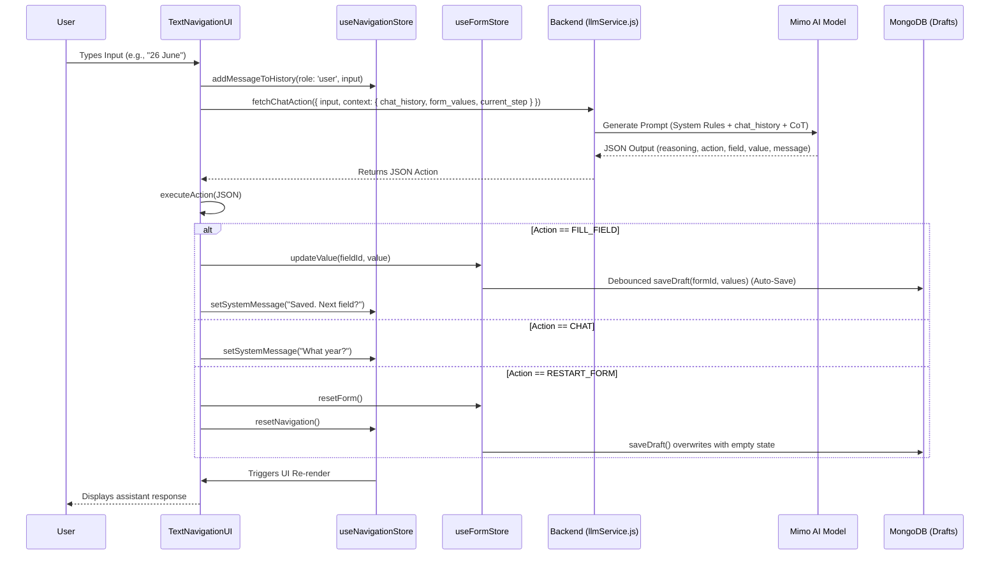

# Accessibility Navigation Engine Documentation

## Overview

The Accessibility Navigation Engine is the core system driving our voice-first, accessible web application. It allows users to interact with complex government service workflows (like a Scholarship Application Form) purely through conversational text. 

The architecture strictly separates **reasoning** (the LLM) from **execution** (the Frontend). The LLM is never allowed to directly manipulate the DOM. Instead, it interprets user intent and outputs strictly constrained JSON actions that the frontend validates and executes.

---

## 🏗 Architecture Diagram

---

## 🧠 Core Architectural Pillars

### 1. Zero-Hallucination Pipeline (Chain of Thought)
To prevent the LLM from making dangerous assumptions (e.g., guessing a birth year when only a day and month are provided), the system enforces a **Chain of Thought (CoT)** verification pattern.
Before outputting any action, the LLM must generate a `reasoning` block evaluating a four-step checklist:
1. Identify the exact raw input.
2. Identify the target field.
3. Verify if the input is 100% complete without guessing.
4. Decide the action (`FILL_FIELD` if complete, `CHAT` if incomplete).

This self-evaluation intercepts hallucination attempts before the JSON action is constructed.

### 2. Conversational Memory Pipeline
Stateless LLM interactions break down during multi-turn clarifications. To solve this, the frontend utilizes `useNavigationStore` to maintain a robust `stepHistory` array.
* **Granularity**: History is tracked independently for *each step* of the form.
* **Injection**: When a user submits an input, the full history array for the current step is sent to the backend as `chat_history`.
* **Result**: The LLM natively remembers the entire conversation leading up to the current field, allowing users to provide data piecemeal (e.g., providing the day, then the month, then the year).

### 3. Strict Action Dispatcher
The `actionDispatcher.js` is the boundary where AI reasoning converts to deterministic UI state changes. It listens for strict vocabulary:
* `NAVIGATE_STEP` / `NEXT` / `PREVIOUS`: Handles form pagination.
* `FILL_FIELD` / `CLEAR_FIELD`: Manipulates `useFormStore` values.
* `CHAT` / `EXPLAIN_FIELD`: Triggers conversational responses without mutating form data.
* `RESTART_FORM`: Wipes both the navigation and form state simultaneously.

### 4. Resilient Auto-Save (Backend Drafts)
To prevent catastrophic data loss for accessibility users, form progress is automatically synced to the backend:
* **Database**: MongoDB stores a `Draft` document linking the `userId` to the `formId`.
* **Debouncing**: `AccessibleForm.jsx` listens to changes in `values` and `currentStepIndex`. Changes trigger a 1.5-second debounced API call to `POST /api/drafts/save`.
* **Seamless Resumption**: Upon mounting, the form automatically fetches `GET /api/drafts/:formId`. If a draft exists, it instantly populates the global Zustand state, restoring both the filled data and the user's pagination location.
